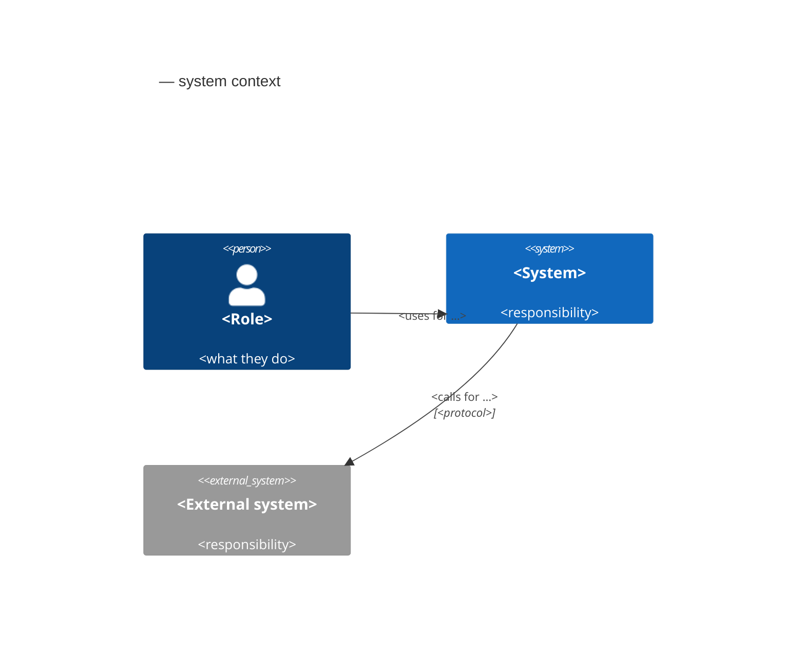
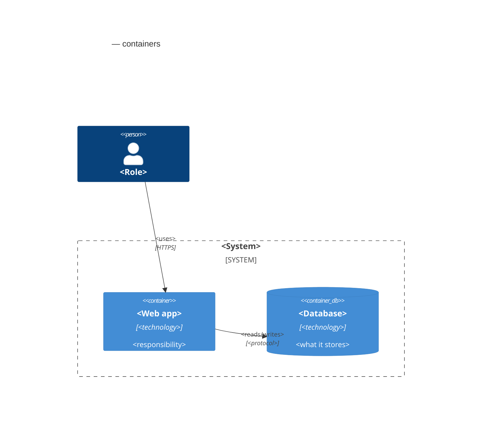
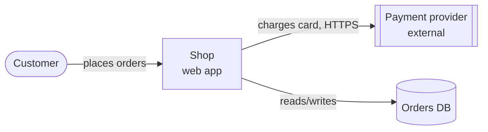

# Architecture diagrams (C4, optional)

Sources (references only): the C4 model by Simon Brown — https://c4model.com/ (site content CC BY 4.0; levels: system
context, container, component, code) · Mermaid C4 diagrams (`C4Context`, `C4Container`; marked experimental by
Mermaid) — https://mermaid.js.org/syntax/c4.html.

Use in design.md `## Architecture (C4)` when the change adds or changes a system boundary, an external system or a
container (deployable/runnable unit, data store). Levels 1–2 only (Context, Container); components belong to
`## Components` as text; code-level diagrams never (that is the skeleton). Skip it for a change inside one container.

## Template — Context (level 1)

## Template — Container (level 2)

## Fallback (renderers without C4 support)

Shapes: `([…])` person, `[…]` container/system, `[[…]]` external system, `[(…)]` data store. No lint.
