# State machines (lifecycles)

Sources (references only): Mermaid state diagrams (`stateDiagram-v2`) — https://mermaid.js.org/syntax/stateDiagram.html ·
UML 2.5.1 state machine concepts (state, event, guard, effect/action, transition) — https://www.omg.org/spec/UML/2.5.1.

Two places:
- **Business lifecycle (b)** — an entity users see moving through states (order, application, subscription): a
  `### Rule:` block in the spec delta. Signal: ≥ 3 states or guarded transitions (`shared/artifacts.md`).
- **Technical state machine (a)** — internal states (job runner, connection, saga): design.md `## State machines`.

## Template
````
### Rule: <KEY>-BR<n> <Entity> lifecycle
<one sentence: which entity, what the states mean>



```mermaid
stateDiagram-v2
  [*] --> <first>
  <from> --> <to> : <event>
  <last> --> [*]
```

| from | event | guard | action | to |
|---|---|---|---|---|
| [*] | <event> | — | — | <first> |
| <from> | <event> | <condition or —> | <effect or —> | <to> |
````
- The table is normative (it is reviewed and traced); the diagram is the picture of the same transitions.
- `[*]` = initial (in `from`) / final (in `to`). Column names stay English; state and event names follow the user's
  language and the glossary (a state name used in requirements is a glossary term).
- In a business lifecycle, events and actions are business words ("payment received", "notify customer").

## Example
See `tests/fixtures/standards/good/spec.md` (`ORD-BR2 Order lifecycle`).

## Warnings
`SM_COLUMNS` (missing from/event/to) · `SM_NONDETERMINISTIC` (same from + event + guard leads to two states) ·
`SM_UNREACHABLE` (state not reachable from `[*]`, or from the first row's `from`) · `SM_DIAGRAM_MISMATCH` (table and
diagram transitions differ) · `SM_MERMAID` (`stateDiagram` instead of `stateDiagram-v2`).
