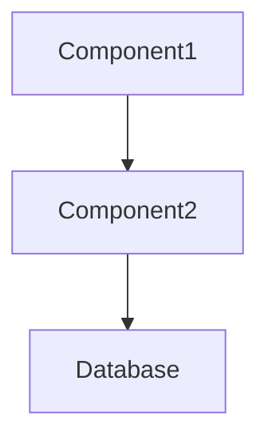

# Tech Stack Roles
<!-- AUTO-GENERATED:BEGIN tech-stack-roles -->
- [Tech + major version] → [role]
- [Tech + major version] → [role]
<!-- AUTO-GENERATED:END tech-stack-roles -->

# Component Roles
<!-- AUTO-GENERATED:BEGIN component-roles -->
- [component dir, e.g. src/services/] → [responsibility]
- [component dir] → [responsibility]
<!-- AUTO-GENERATED:END component-roles -->

# System Interactions
<!-- AUTO-GENERATED:BEGIN system-interactions -->

<!-- AUTO-GENERATED:END system-interactions -->

# Boundaries & Public Interfaces
<!-- AUTO-GENERATED:BEGIN boundaries -->
- [entry point / HTTP routes / CLI / exported package API] → [where it lives, who calls it]
- [external system] ← [adapter/module that talks to it]
<!-- AUTO-GENERATED:END boundaries -->

# Notes
Text outside AUTO-GENERATED blocks is MANUAL and is never changed by /hitl:overview.
Signatures live in CODEBASE-MAP.md (generated from the AST index), not here.
