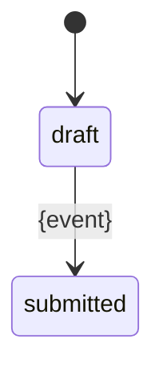

<!-- audience: business -->
<!-- Adapted from Fission-AI/OpenSpec (MIT) — see NOTICE.md. Source: docs/concepts.md (delta specs) @ 6d04a1b. Changes: id identity (no RENAMED), Rules/Flows kinds, required Changed:/Reason: lines. -->
# Delta: {Capability title}
> capability: {capability} | key: {KEY} | change: {change-id}

<!-- ## Purpose is required only when the capability is new (then only ADDED sections are allowed).
     Ids come from `hitl-index spec next-id {capability} --kind R|BR|UC` and `--scenario <REQ-ID>`; ids never change.
     Omit empty sections. RENAMED is not supported: a new title is a MODIFIED block.
     Formats per standard: shared/formats/README.md (one SHALL per requirement, no vague words — spec validate warns). -->
## Purpose
{who uses this business area and what it is for}

## ADDED Requirements
### Requirement: {KEY}-R{n} {Requirement title}
When {trigger}, the system SHALL {observable response}.

#### Scenario: {KEY}-R{n}.S1 {Scenario title}
- GIVEN {context}
- WHEN {action}
- THEN {observable outcome}

### Requirement: {KEY}-R{p} {Quality requirement title}
<!-- NFR (shared/formats/requirement-quality.md): ISO/IEC 25010:2023 characteristic + measurable Volere-style fit criterion -->
While {condition}, the system SHALL {response} within {number + unit} for {share} of {cases}.
Quality: performance-efficiency (time behaviour)
<!-- one of: functional-suitability, performance-efficiency, compatibility, interaction-capability, reliability, security,
     maintainability, flexibility, safety (+ optional sub-characteristic in parentheses) -->
Fit: {metric, threshold, how it is measured}

#### Scenario: {KEY}-R{p}.S1 {Scenario title}
- GIVEN {load or context}
- WHEN {action}
- THEN {measurable outcome}

## MODIFIED Requirements
<!-- the FULL new block, including unchanged scenarios, then one "Changed:" line -->
### Requirement: {KEY}-R{m} {Requirement title}
When {trigger}, the system SHALL {new observable response}.

#### Scenario: {KEY}-R{m}.S1 {Scenario title}
- GIVEN {context}
- WHEN {action}
- THEN {observable outcome}
Changed: {one line: what changed and why}

## REMOVED Requirements
### Requirement: {KEY}-R{r} {Requirement title}
Reason: {why it is removed}

## ADDED Rules
### Rule: {KEY}-BR{n} {Rule title}
{the policy in one or two sentences}

<!-- optional decision table (OMG DMN, shared/formats/decision-tables.md): hit policy + (in)/(out) columns -->
Hit policy: U (unique)

| # | {input} (in) | {input} (in) | {output} (out) |
|---|---|---|---|
| 1 | {condition} | {condition} | {value} |

### Rule: {KEY}-BR{m} {Entity} lifecycle
<!-- optional business lifecycle (shared/formats/state-machines.md): the table is normative, the diagram mirrors it -->
{which entity, what its states mean}

| from | event | guard | action | to |
|---|---|---|---|---|
| [*] | {event} | — | — | draft |
| draft | {event} | {condition or —} | {effect or —} | submitted |

## ADDED Flows
### Flow: {KEY}-UC{n} {Flow title}
<!-- Cockburn fully dressed (lite), shared/formats/use-cases.md -->
Primary actor: {role} · Scope: {capability} · Level: user goal
Preconditions: {what is already true, or none}
Trigger: {what starts it}
Success guarantee: {what is true when the goal is met}
Main success scenario:
1. {actor} {does something}.
2. The system {responds} ({KEY}-R{n}).
Extensions:
2a. {condition}: {what happens}; {ends | continues at step n}.
