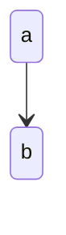

<!-- audience: dev -->
# Design: Order lifecycle
> change: feat-order-lifecycle | status: draft | updated: 2026-10-27

## Decisions
| id | decision | why | alternatives | cost if wrong | serves | status |
|----|----------|-----|--------------|---------------|--------|--------|
| D-1 | State column | simple | event log | audits | — | superseded by D-9 |
| D-2 | Cache | speed | none | stale | — | deprecated |

### D-1 State column
- **Context and problem**: x
- **Decision outcome**: (1)

### D-7 Ghost
- **Context and problem**: y

## State machines

| from | to |
|---|---|
| a | b |
