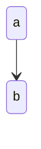

<!-- audience: dev -->
# Design: Order lifecycle
> change: feat-order-lifecycle | status: draft | updated: 2026-10-27

## Decisions
| id | decision | why | alternatives | cost if wrong | serves | status |
|----|----------|-----|--------------|---------------|--------|--------|
| ORD-D1 | State column | simple | event log | audits | — | superseded by ORD-D9 |
| ORD-D2 | Cache | speed | none | stale | — | deprecated |

### ORD-D1 State column
- **Context and problem**: x
- **Decision outcome**: (1)

### ORD-D7 Ghost
- **Context and problem**: y

## State machines

| from | to |
|---|---|
| a | b |
