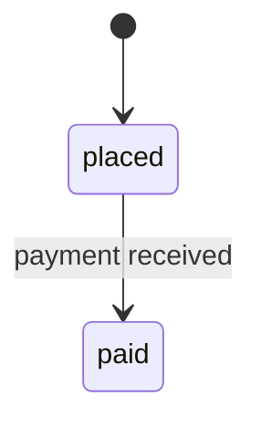

<!-- audience: business -->
# Delta: Orders
> capability: orders | key: ORD | change: feat-order-lifecycle

## Purpose
Orders.

## ADDED Requirements
### Requirement: ORD-R1 Place an order
When a customer confirms a cart, the order SHALL be created and the customer MUST see a fast, user-friendly page.

#### Scenario: ORD-R1.S1 Cart
- WHEN they confirm
- THEN an order exists

### Requirement: ORD-R2 Order page response time
The system SHALL show the order page quickly and/or efficiently.
Quality: performance-efficiency

#### Scenario: ORD-R2.S1 Busy shop
- WHEN a customer opens an order page
- THEN the page is shown

### Requirement: ORD-R3 Trang đơn hàng
Hệ thống SHALL hiển thị trang đơn hàng nhanh và thân thiện, v.v.

#### Scenario: ORD-R3.S1 Mở trang
- WHEN khách mở trang
- THEN trang hiển thị

## ADDED Rules
### Rule: ORD-BR1 Shipping fee
| order total | member | shipping fee |
|---|---|---|
| < 50 | no | 5 |

### Rule: ORD-BR2 Discount
Hit policy: U

| # | order total (in) | member (in) | discount (out) |
|---|---|---|---|
| 1 | >= 100 | any | 10% |
| 2 | >= 50 | yes | 5% |
| 3 | < 50 | yes | 0% |

### Rule: ORD-BR3 Bad policy
Hit policy: X

| # | a (in) | b (out) |
|---|---|---|
| 1 | x | y |

### Rule: ORD-BR4 Order lifecycle

| from | event | guard | action | to |
|---|---|---|---|---|
| [*] | order created | — | — | placed |
| placed | payment received | — | — | paid |
| placed | payment received | — | — | cancelled |
| refunded | archived | — | — | [*] |

## ADDED Flows
### Flow: ORD-UC1 Buy a product
Primary actor: customer
Main success scenario:
1. The customer confirms the cart.
2. The system creates the order.
Extensions:
5a. Payment fails: the customer retries.

### Flow: ORD-UC2 Nobody
The customer buys something.
