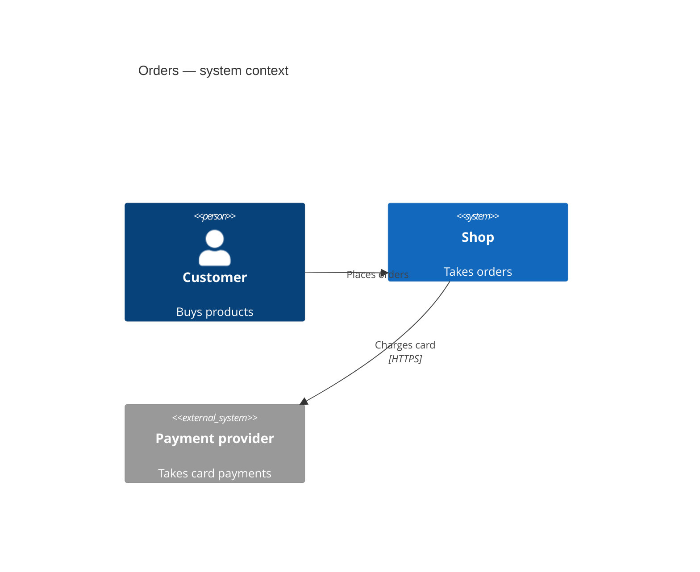

<!-- audience: dev -->
# Design: Order lifecycle
> change: feat-order-lifecycle | status: draft | updated: 2026-10-27

## Context
- Orders are stored by the shop service (source: src/orders/)

## Architecture (C4)

## Decisions
| id | decision | why | alternatives | cost if wrong | serves | status |
|----|----------|-----|--------------|---------------|--------|--------|
| D-1 | Keep the order state in one column with a check constraint | simple, queryable | event log | slow audits | — | accepted |
| D-2 | Event-sourced orders | full audit | state column | complexity | — | superseded by D-1 |
| D-3 | Cache order pages | speed | none | stale pages | — | proposed |

### D-1 Order state in one column
- **Context and problem**: orders move through five states; support needs to query by state.
- **Decision drivers**: query by state; low complexity.
- **Considered options**: (1) state column + check constraint (2) event log (3) one table per state.
- **Decision outcome**: (1), because it meets both drivers with the existing database.
- **Consequences**: Good: one query per state. Bad: no history (accepted: audit log covers payments).
- **Confirmation**: a migration test rejects an unknown state.

## State machines
| from | event | guard | action | to |
|---|---|---|---|---|
| [*] | create | — | — | placed |
| placed | pay | — | — | paid |

## Contracts
- contracts/orders.openapi.yaml — public HTTP API
- contracts/order-events.asyncapi.yaml — order events
- contracts/order.schema.json — order payload
- contracts/cli.md — admin CLI

## Changelog
