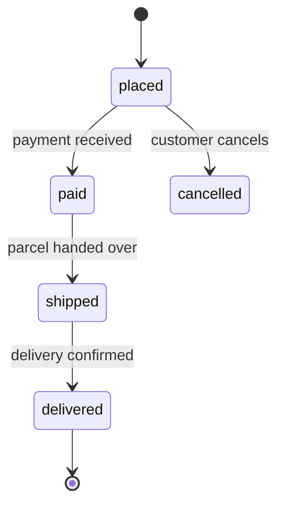

<!-- audience: business -->
# Delta: Orders
> capability: orders | key: ORD | change: feat-order-lifecycle

## Purpose
How customers place orders and how an order moves from placed to delivered.

## ADDED Requirements
### Requirement: ORD-R1 Place an order
When a signed-in customer confirms a cart with at least one item, the system SHALL create an order in state "placed".
Rules: ORD-BR1, ORD-BR2

#### Scenario: ORD-R1.S1 Cart with one item
- GIVEN a signed-in customer with 1 item in the cart
- WHEN they confirm the cart
- THEN an order in state "placed" is shown

### Requirement: ORD-R2 Order page response time
While up to 500 customers use the shop at the same time, the system SHALL show the order page within 2 seconds for 95% of requests.
Quality: performance-efficiency (time behaviour)
Fit: 95th percentile page time ≤ 2 s in a 500-user load test

#### Scenario: ORD-R2.S1 Busy shop
- GIVEN 500 customers use the shop at the same time
- WHEN a customer opens an order page
- THEN the page is shown within 2 seconds

### Requirement: ORD-R3 Accessible checkout
The system SHALL let a customer complete checkout with a keyboard only.
Quality: interaction-capability
Fit: an accessibility audit completes checkout with keyboard only, without a mouse

#### Scenario: ORD-R3.S1 Keyboard only
- GIVEN a customer who uses only a keyboard
- WHEN they check out
- THEN the order is placed

## ADDED Rules
### Rule: ORD-BR1 Shipping fee
The shipping fee depends on the order total and the membership.

Hit policy: U (unique)

| # | order total (in) | member (in) | shipping fee (out) |
|---|---|---|---|
| 1 | < 50 | no | 5 |
| 2 | < 50 | yes | 0 |
| 3 | >= 50 | any | 0 |

### Rule: ORD-BR2 Order lifecycle
An order moves only along these transitions.

| from | event | guard | action | to |
|---|---|---|---|---|
| [*] | order created | — | — | placed |
| placed | payment received | amount = total | send receipt | paid |
| placed | customer cancels | — | — | cancelled |
| paid | parcel handed over | — | notify customer | shipped |
| shipped | delivery confirmed | — | — | delivered |
| delivered | archived | — | — | [*] |

## ADDED Flows
### Flow: ORD-UC1 Buy a product
Primary actor: customer · Scope: shop · Level: user goal
Stakeholders: customer wants the product fast to choose; shop owner wants paid orders only
Preconditions: the customer is signed in
Trigger: the customer opens the cart
Success guarantee: an order in state "placed" exists and the customer sees its number
Minimal guarantee: no payment is taken without an order
Main success scenario:
1. The customer reviews the cart.
2. The customer confirms the cart.
3. The system creates the order (ORD-R1) and shows its number.
Extensions:
2a. The cart is empty: the system asks the customer to add an item; the use case ends.
3a. The shop is closed: the system keeps the cart and shows when it reopens.
